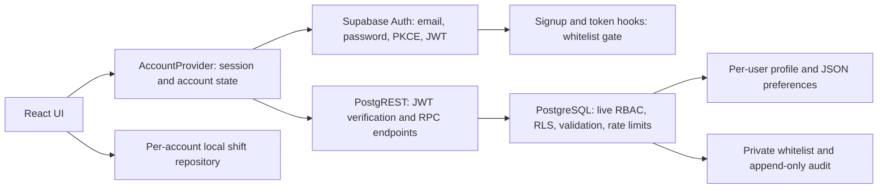

# Phase 2: accounts, access control and persistent preferences

## Delivery and scope

Phase 2 is implemented with the setup steps below. Public connection values have been configured for the owner’s Supabase project; its database endpoint and email/confirmation settings were checked remotely. The owner confirmed the administrator bootstrap and both Auth hooks are enabled. Creating the first app account and validating email delivery still require the owner to complete signup. See GitHub Actions for the current deployment result.

The frontend remains React + Vite, deployable to GitHub Pages. Supabase supplies Auth, PostgreSQL and a JWT-protected REST API. No custom password database, server secrets or paid application server is needed in the frontend. Supabase manages password hashing and refresh token rotation. Use the platform's email/password provider; OAuth is not included in this release.

Profiles and preferences persist in the database. Existing shifts, hourly rates, bonus rules and payouts remain in browser localStorage, separated by user ID after sign-in. This phase does not introduce cloud synchronization of financial records. Local/browser-only mode remains available when **both** Supabase build variables are absent and `VITE_REQUIRE_AUTH` is false. Set the required-auth flag for any account-enabled release; partial or invalid configuration fails closed.

## Architecture



- `AccountGate` prevents signed-out/restricted users from rendering the tracker when accounts are configured.
- The Supabase API verifies JWTs. Every sensitive RPC checks the current verified user's live whitelist membership. RLS protects direct profile/settings reads. The browser's route/tab guard is an interface convenience, not an authorization boundary.
- `AccountProvider` is the shared client state. Successful profile and preference writes update it immediately without a full reload; the display name, avatar, theme, density and currency follow that state. Settings writes are serialized within a tab.
- Profile and settings version numbers provide optimistic concurrency. A stale write gets HTTP 409. The UI offers **Reload account**, then the user can retry deliberately; it does not silently overwrite another session's changes.
- A focus/60-second check refreshes access and state. Database revocation applies on the next protected request immediately; an already-rendered interface is removed on the next access check. No remote control can erase previously downloaded data or a user's local records.

## Database models

The exact executable schema is `supabase/migrations/202610290001_accounts.sql`.

| Table | Important columns | Authorization / purpose |
| --- | --- | --- |
| `auth.users` | UUID `id`, verified email, provider-managed credentials | Managed by Supabase Auth; the app does not write credential rows |
| `private.access_list` | normalized email PK, nullable unique `user_id`, `role` (`user`/`admin`), `active`, timestamps, `updated_by` | Only owner-operated setup scripts or authenticated admin RPCs change membership |
| `public.profiles` | `user_id` PK/FK, `display_name` (80 chars), optional HTTPS `avatar_url`, `bio` (1,000 chars), `version`, `updated_at` | Own active-user reads only; writes only through validated self-scoped RPC |
| `public.user_settings` | `user_id` PK/FK, `preferences JSONB`, `version`, `updated_at` | Own active-user reads; RPC-only writes with 16 KB object limit |
| `private.access_audit` | identity PK, actor UUID, target email, old/new membership JSON, timestamp | Append-only for app callers; admins read a bounded cursor page |
| `private.write_limits` | `(user_id, action)` PK, minute window and count | Enforces committed mutation limits; bounded to one row per user/action |

An email invitation is linked to its first verified auth user ID on bootstrap. The server checks both current verified email and bound ID. A regular user cannot submit a different owner ID to write another user's records, cannot change roles via profile metadata, and cannot directly write tables. Administrators manage access but do not receive access to other users' profiles/settings. Earnings stay in local storage.

A profile/settings row is created idempotently on the first authorized account bootstrap. Foreign keys cascade on auth user deletion for profile/settings/limiter rows. Access and audit actor references are set to null on deletion. Revoke an email before deleting an identity if it should not be eligible to register again. There is no hard-delete action in the admin interface.

### Preference shape and evolution

```json
{
  "theme": "light",
  "notifications": false,
  "density": "comfortable",
  "currency": "EUR",
  "futureFeature": {"any": "JSON value"}
}
```

Known UI keys are validated by the database and client. Unknown extension keys are preserved. `put_settings` replaces the entire object; omitted UI keys use client defaults. `patch_settings` performs an atomic **shallow top-level merge**. Nested values replace in full. Null is stored for arbitrary keys; null is invalid for the four reserved keys. This is not JSON Merge Patch/RFC 7396. Use a schema migration if introducing a new required/reserved preference. Promote frequently filtered preferences to indexed typed columns when actual queries warrant it.

Notifications are a stored opt-in preference only. No email scheduler or browser notification delivery is implemented.

## API contract

`BASE=https://YOUR-PROJECT.supabase.co`. The SDK supplies these headers automatically:

```http
apikey: YOUR_PUBLIC_PUBLISHABLE_KEY
Authorization: Bearer USER_ACCESS_TOKEN
Content-Type: application/json
```

The key identifies the project and is public; the signed access token identifies the user. Never use a service-role or secret key in browser code. There is no caller-supplied user ID for mutations.

| HTTP method and path | Purpose / request body |
| --- | --- |
| `POST /auth/v1/signup` | Approved-email account creation: `{email,password}`; email confirmation required |
| `POST /auth/v1/token?grant_type=password` | Login: `{email,password}` |
| `POST /auth/v1/token?grant_type=refresh_token` | SDK-managed session refresh |
| `POST /auth/v1/recover` | Request password recovery; neutral success message |
| `PUT /auth/v1/user` | Authenticated password update following recovery |
| `POST /auth/v1/logout` | SDK sign-out; app uses local-session scope |
| `POST /rest/v1/rpc/account_bootstrap` | `{}` → `{access,profile,settings}` for the current verified user |
| `GET /rest/v1/profiles?select=*` | Read the current user's row; RLS filters out all others |
| `GET /rest/v1/user_settings?select=*` | Read current settings and version |
| `POST /rest/v1/rpc/update_profile` | `{p_display_name,p_avatar_url,p_bio,p_expected_version}` → updated profile |
| `POST /rest/v1/rpc/put_settings` | `{p_preferences,p_expected_version}` → replace preferences |
| `POST /rest/v1/rpc/patch_settings` | `{p_preferences,p_expected_version}` → merge top-level keys atomically |
| `POST /rest/v1/rpc/admin_list_access` | Admin only: `{p_offset:0,p_limit:50}`; maximum page size 100 |
| `POST /rest/v1/rpc/admin_set_access` | Admin only: `{p_email,p_role:"user",p_active:true}`; add, change role, restore or revoke (`false`) |
| `POST /rest/v1/rpc/admin_audit` | Admin only: `{p_before:null,p_limit:50}`; cursor is last audit `id` |

Replacement and patch operations deliberately use PostgREST's real **POST RPC** routes. They are not fictitious HTTP PUT/PATCH URLs; direct table mutation is revoked. This keeps validation, version checks, merging, authorization and write rate limits in one transaction.

Settings patch example after reading version 1:

```http
POST /rest/v1/rpc/patch_settings

{"p_preferences":{"theme":"dark","density":"compact"},"p_expected_version":1}
```

Returns a JSON object such as:

```json
{"user_id":"CURRENT-USER-UUID","preferences":{"theme":"dark","density":"compact","currency":"EUR","notifications":false},"version":2,"updated_at":"2026-10-29T00:00:00Z"}
```

Important responses: 401 for missing/invalid authentication at the API; 403 for restricted membership/admin actions; 409 for stale profile/settings versions; 429 for the database mutation limiter. Input/constraint failures return a 4xx PostgREST error. Direct SELECT with a nonmatching RLS policy returns an empty array rather than leaking rows. Do not mistake that for authorized access.

## Security controls and limits

1. **Passwords and sessions:** Supabase Auth handles hashing, confirmation, password recovery and token rotation. No passwords enter localStorage or app tables. The SDK refreshes sessions automatically. Access and refresh tokens are stored in `sessionStorage` for this tab. Only the one-time PKCE verifier is shared through localStorage so a confirmation/reset email can open in another tab of the same browser profile. A shared verifier is consumed by the SDK on callback. For simultaneous recovery attempts, complete one before requesting another.
2. **Cookie choice:** GitHub Pages cannot set an application server's HttpOnly auth cookies. This implementation uses bearer JWTs, an allowed alternative in the brief. JavaScript-readable storage remains exposed to XSS. After sign-out, an already-issued access JWT may remain valid until its expiry; whitelist revocation blocks database requests immediately. A same-origin backend-for-frontend is the next architecture step if HttpOnly cookie sessions are required; it would also need CSRF protection.
3. **Whitelist enforcement:** Install both Auth hooks. `before_user_created` rejects unapproved signups; `custom_access_token` rejects unapproved/unverified token issuance and refresh. Protected RPCs and RLS also consult live database membership, so a previously issued JWT cannot bypass revocation. The message is “Access restricted. Your email must be approved by an administrator.” Auth errors are mapped for clarity; invalid credentials use a generic message.
4. **RBAC:** Roles live in the private access table, never user-editable metadata. The token's `app_role` claim is informational; database authorization reads current roles. Administrative changes are serialized with a transaction lock. Admins cannot modify their own role/access, preventing self-lockout and preserving at least one active admin. The project owner can recover admin access with the SQL bootstrap script.
5. **Database boundaries:** Every app table has RLS. Anonymous/profile/settings mutation grants are explicitly revoked. Private tables are not exposed by the REST API. Exposed RPC wrappers use `security invoker`; narrowly scoped private `security definer` functions pin an empty `search_path`, schema-qualify names and perform their own ownership/role checks. Function execute privileges are explicitly narrowed. Do not add `private` to exposed schemas.
6. **Validation and injection:** Parameterized SDK calls, SQL constraints and validated RPCs enforce lengths, types, email normalization, avatar HTTPS URLs, preference object size and known values. There is no dynamic SQL and no HTML rendering of display names/bios. Production builds add a CSP permitting scripts only from the app origin and connections only to the app/Supabase origin. External HTTPS avatar images are permitted and disclose the viewer's IP to the image host; the UI explains this and uses `no-referrer`. Avatar upload/storage is not included.
7. **Rate limiting:** Supabase applies configurable Auth limits to login/signup/refresh/recovery. Configure and test them in the project. Database RPCs allow 60 committed profile or settings changes per user/action/minute and 30 access changes per admin/minute. Rejected transactions roll back their counters, so these are not a general brute-force/invalid-request or IP limiter. Read traffic and malformed requests need platform/gateway limits appropriate to your deployment. Production SMTP is needed for reliable member confirmation/recovery; the default service is intended for trials.
8. **Concurrency and logging:** Database version checks return `PT409`, not SQLSTATE `40001` (which can cause unexpected retries on some PostgREST releases). Whitelist changes have old/new audit snapshots. Never log passwords, raw JWTs or refresh tokens. Restrict project dashboard/database access and keep backups under the owner's control.
9. **Privacy:** Signing out removes account state and local auth tokens. It does not delete financial backups or browser shift records. Account-local storage isolation prevents accidental mixing; it does not encrypt local records against someone who has access to the same browser profile. Email-address changes through the provider require the new email to be approved; no email-change UI is included.

## Step-by-step activation from no Supabase project

### 1. Create the backend

1. Visit https://supabase.com/dashboard and create an account/organization, then a new project. Select a region appropriate for your users and save the project database password securely.
2. In the project SQL Editor, run `supabase/migrations/202610290001_accounts.sql` once. Alternatively, link the project with Supabase CLI and run `supabase db push`. Do not run the migration repeatedly against a live schema; use a new migration for later changes.
3. Open `supabase/bootstrap-admin.sql`, replace `REPLACE_WITH_YOUR_EMAIL` with the administrator email you will verify, then run it in SQL Editor as project owner. The placeholder deliberately fails until edited. This approves the address before signup and records an owner-operated bootstrap event.

### 2. Configure authentication before creating users

1. Under Authentication, enable **Email** authentication and **Confirm email**. Anonymous sign-in is not supported; keep it off. Disable unused providers.
2. Configure a minimum password length of **12**, password strength protections and appropriate Auth rate limits in Supabase. The frontend length check alone does not protect direct API calls.
3. Configure production SMTP for confirmation/reset emails and test delivery. Do not assume the default trial mailer will serve arbitrary external users reliably.
4. Under **Authentication → Hooks**, enable the PostgreSQL **Before User Created** hook and select `public.before_user_created`.
5. Enable the PostgreSQL **Custom Access Token** hook and select `public.custom_access_token`. These two hook types are documented as available on the free plan; verify project availability when setting up.
6. Verify `private` is **not** in the Data API's exposed schemas. Expose `public` as usual. No service-role key is needed in the frontend.
7. Set **Authentication → URL Configuration → Site URL** to `https://muffin4lol.github.io/shift-pay-tracker/`.
8. Add exact additional redirect URLs `https://muffin4lol.github.io/shift-pay-tracker/` and `http://localhost:5173/`. Use a separate staging project's localhost redirect in stricter production deployments. Keep redirects narrow; do not add broad wildcard origins.
9. Choose an access-token lifetime appropriate to your security/UX needs, such as 15–60 minutes. Revocation checks use live membership regardless of token lifetime. Session idle/max lifetime restrictions may depend on the Supabase plan; they are not implemented by the frontend.

### 3. Connect and run locally

1. Copy `.env.example` to `.env.local` (ignored by Git).
2. From the Supabase Connect/API keys view, copy the project URL and **publishable key**. A legacy **anon** key also works. Never copy a secret or service-role key.
3. Set:

```dotenv
VITE_SUPABASE_URL=https://YOUR-PROJECT.supabase.co
VITE_SUPABASE_PUBLISHABLE_KEY=YOUR_PUBLIC_PUBLISHABLE_KEY
VITE_REQUIRE_AUTH=true
```

4. Install and start:

```sh
npm ci
npm test
npm run dev
```

5. Open the Local URL, choose **Create an account**, use the bootstrapped admin email and a strong password, then follow the confirmation email in the same browser profile. Sign in if prompted.
6. Open **Admin**, approve a second email as a **Member**, and have that person create/confirm an account. An admin can approve an email but cannot send an invitation email from this interface; communicate the site URL separately.
7. In **Account**, save a display name, optional trusted avatar URL and bio. Save preferences and confirm the header/sidebar and theme update without a reload.

### 4. Acceptance checks against the actual project

The local PostgreSQL tests cannot verify the hosted Auth service. Complete this checklist before enabling the release:

- Approved admin signup, confirmation, password login and refresh succeed.
- Unapproved signup fails at the Before User Created hook; direct password login/token refresh for a revoked member fails at the Custom Access Token hook.
- Wrong credentials use a neutral failure message; password recovery email and PKCE callback work, including opening the link in a new tab of the same browser profile.
- Member sees no Admin tab; invoking `admin_list_access`/`admin_set_access` directly with the member token returns 403.
- Attempt direct profile/settings reads with another user's UUID and verify no rows are returned. Direct UPDATE/INSERT on public tables and private-table REST access must fail.
- As admin, revoke a signed-in member. With their existing token, attempt profile/settings writes and reads: writes return 403, reads disclose no rows. Restore access, sign in again, verify records remain.
- Change the profile and preferences, sign out and sign in again, and verify database persistence. Confirm another account does not inherit the first user's local shifts or profile.
- Open two sessions with the same settings version. Save in one, then in the other: the latter must receive 409 and recover by Reload account, not overwrite silently.
- Confirm 429 under the mutation threshold test and provider Auth rate-limit behavior without repeatedly sending real mail.
- Try removing your own admin access; it must fail. Review the access audit after changes.
- Test keyboard-only navigation, mobile layout and a shared-device sign-out. No sensitive UI should render before bootstrap authorization.

Use a disposable staging project and test addresses for destructive/revocation checks.

### 5. Publish Phase 2 when setup is ready

1. In GitHub repository **Settings → Secrets and variables → Actions → Variables**, create these repository variables (all public configuration):

| Repository variable | Value |
| --- | --- |
| `SUPABASE_URL` | Your project URL |
| `SUPABASE_PUBLISHABLE_KEY` | Your publishable/anon key |
| `REQUIRE_AUTH` | `true` |

2. The included workflow passes these into `VITE_SUPABASE_URL`, `VITE_SUPABASE_PUBLISHABLE_KEY` and `VITE_REQUIRE_AUTH` during `npm run build`. It still sets the GitHub Pages base path. Missing required config fails the build rather than silently publishing browser-only mode.
3. Push the prepared branch, review it, and merge to `main` after the project acceptance checks pass:

```sh
git push -u origin phase-2-accounts
```

Authenticate Git if necessary using GitHub Desktop, Git Credential Manager or `gh auth login`. Do not put access tokens in Git remote URLs.

4. Open a pull request from `phase-2-accounts` to `main` in GitHub, review the database/setup steps, then merge. The workflow tests and builds PRs without deployment; pushes to `main` test/build/deploy.
5. Verify green jobs under Actions and open `https://muffin4lol.github.io/shift-pay-tracker/`. The deployed release should now show Sign in before the tracker. Finish the live smoke checks above.
6. Before the switch, export your Phase 1 shifts from **Settings → Download JSON backup**. After signing into your account, restore that backup to migrate your records into your account-specific local workspace. If you did not export before the switch, Account → Download original browser backup lets you recover the original records from the same browser; then restore them under Settings. This is an explicit per-device operation; no anonymous/shared browser records are automatically copied to a user.

## Implementation sequence and file map

1. Schema, RLS, private RBAC helpers and hooks: `supabase/migrations/202610290001_accounts.sql`.
2. Owner bootstrap with placeholder guard: `supabase/bootstrap-admin.sql`.
3. Managed Auth client and validated config: `src/account/client.js`, `src/account/model.js`.
4. Session lifecycle, protected rendering, login/recovery and shared state: `src/account/AccountProvider.jsx`.
5. Profile/preferences UI: `src/account/AccountPanel.jsx`.
6. Paginated whitelist management and audit UI: `src/account/AdminPanel.jsx`.
7. Tracker integration, account-specific local repository, responsive styling: `src/main.jsx`, `src/storage.js`, `src/style.css`.
8. Config/CSP and deployment variables: `vite.config.js`, `.env.example`, `.github/workflows/deploy.yml`.
9. Automated checks: `tests/account.test.js`, `tests/database.test.js` and original `tests/pay.test.js`.
10. Project creation, Auth hook activation, SMTP, redirects, hosted acceptance and deployment: owner steps above; not performed without a project.

The database test suite executes the **actual migration** on PostgreSQL via PGlite, with minimal Supabase Auth roles/schema/identity stubs. It tests RLS, RPC grants, direct-write rejection, verified membership, admin checks, profile persistence, JSON merge/replace, optimistic conflicts, rate limits, audit, revocation and Auth hook return values. It does not simulate Supabase's JWT signature verification, Auth HTTP service, SMTP or dashboard configuration. The test dependency runs only in Node, not in the shipped browser bundle.

## References checked for this implementation

- Managed Auth and JWT/API integration: https://supabase.com/docs/guides/auth
- Email/password, recovery and confirmation: https://supabase.com/docs/guides/auth/passwords
- Password security: https://supabase.com/docs/guides/auth/password-security
- Auth hooks and grants: https://supabase.com/docs/guides/auth/auth-hooks
- Before User Created: https://supabase.com/docs/guides/auth/auth-hooks/before-user-created-hook
- Custom Access Token: https://supabase.com/docs/guides/auth/auth-hooks/custom-access-token-hook
- RLS and privileges: https://supabase.com/docs/guides/database/postgres/row-level-security
- Database function security: https://supabase.com/docs/guides/database/functions
- Auth limits: https://supabase.com/docs/guides/auth/rate-limits
- Avoid custom serialization-failure errors: https://supabase.com/kb/troubleshooting/high-cpu-and-infinite-transaction-retries-when-using-custom-error-codes-in-rpc-functions
